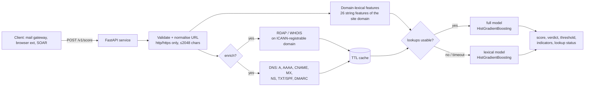

# Phishing URL Detection Pipeline

A gradient-boosting classifier that scores URLs using **domain-lexical**, **WHOIS (RDAP)** and
**DNS** features, served as a hardened **FastAPI** REST service in a non-root Docker image.

The most useful thing this project found is about data, not models. On the public dataset it
uses, a naive model scores F1 ≈ 0.997 by learning **how the URLs were collected**, not what
phishing looks like. The pipeline measures that shortcut, removes it, and reports the honest
numbers next to the inflated ones.

---

## Architecture



Training pipeline: `dataset` (download, de-duplicate) → `enrich_dataset` (live lookups, cached,
resumable) → `train` (grouped splits, ablations, artifact checks) → `report` (writes the Results
section below from `outputs/metrics.json`).

## Dataset

**PhiUSIIL Phishing URL Dataset**, UCI ML Repository #967, **CC BY 4.0**. It has 235,795 URLs
(134,850 legitimate, 100,945 phishing). Only the `URL` and `label` columns are used. The dataset's
page-derived (HTML) features are ignored because this service never fetches the page. Source,
licence and citation are in [data/README.md](data/README.md).

### Dataset artifacts: why the obvious model is wrong

Profiling the raw URLs (`outputs/metrics.json → dataset_artifacts`) shows the two classes were
collected in different formats:

<!-- ARTIFACTS:START -->
| Property (share of URLs) | Legitimate | Phishing |
|---|---:|---:|
| Scheme is `https` | 100.0% | 48.6% |
| Host starts with `www.` | 100.0% | 41.5% |
| No path and no query (bare homepage) | 100.0% | 71.8% |
<!-- ARTIFACTS:END -->

So "is it `http`?", "is there a `www.`?" and "is there a path?" separate the classes almost
perfectly in this dataset. In real traffic they don't: legitimate users click deep links all the
time. A full-URL lexical model trained here gets near-perfect test scores, and permutation
importance shows that almost all of that comes from `path_len` and `is_https`.

**What the pipeline does about it:**

1. **Domain-level scoring.** The served models only see features of the *site domain*: the
   eTLD+1, with public-suffix-list private suffixes enabled so that `evil.web.app` is its own site.
   Scheme, `www.`, subdomains, path and query are excluded from the model. A unit test
   (`test_domain_features_ignore_dataset_artifacts`) fails if any of them leak back in.
2. **One row per site domain**, and every train/validation/test split is grouped by site domain,
   so the model can't memorise a domain it has already seen.
3. The naive full-URL model is still trained, **and reported but never served**, so the size of
   the shortcut is measured rather than asserted.
4. Path and query signals (`@` in the URL, embedded emails, credential keywords, deep subdomain
   nesting) are still surfaced to analysts as **indicators**. They are rule-based heuristics that
   don't feed the score, so the dataset can't teach the model the wrong lesson about them.

## Features

| Group | Count | Examples | Computed on |
|---|---:|---|---|
| Domain lexical | 26 | length, entropy, digit ratio, hyphens, consonant/digit runs, risky/common/ccTLD, brand + extra words, credential keywords, punycode, IP host, shared-hosting suffix | site domain string, offline |
| WHOIS / RDAP | 5 | registry record found, domain age, days to expiry, registration period, days since update | ICANN-registrable domain (RDAP via IANA bootstrap; port-43 WHOIS fallback) |
| DNS | 10 | resolves, # A / AAAA, CNAME, A-record TTL, # MX / NS / TXT, SPF present, DMARC present | site domain, via 1.1.1.1 / 8.8.8.8, TCP retry on UDP loss |

Lookup failures are kept separate from negative answers. NXDOMAIN or "no such domain" are real
values (0). A timeout or resolver error becomes `NaN`, which gradient-boosted trees handle
natively. If both lookups fail, the API falls back to the lexical model and says so in the
response.

## Models

Both models are scikit-learn `HistGradientBoostingClassifier` (histogram gradient-boosted trees,
early stopping, native missing-value support). The decision threshold is chosen on the validation
split (max F1, configurable to a target false-positive rate in `config.yaml`). Every reported
metric comes from a held-out test split of *unseen domains*.

| Model | Features | Training data | Served |
|---|---|---|---|
| `lexical` | 26 domain-lexical | all site domains in PhiUSIIL | fallback / `enrich=false` |
| `full` | 26 lexical + 15 WHOIS/DNS | live-enriched, class-balanced sample | default |
| naive baseline | 50 full-URL lexical | all URLs | **never**: shows the artifact |

## Results

<!-- RESULTS:START -->
_Generated from `outputs/metrics.json` (2026-11-17T17:33:08+00:00, scikit-learn 1.9.1). All splits are grouped by site domain._

**Data:** 235,795 PhiUSIIL rows → 235,362 unique valid URLs (100,512 phishing / 134,850 legitimate).
Domain-level dataset: 197,600 site domains (65,520 phishing / 132,080 legitimate; 106 domains with both labels dropped).

### 1. Whole dataset

| Model (held-out test set) | n | ROC-AUC | PR-AUC | Precision | Recall | F1 | FPR | Note |
|---|---:|---:|---:|---:|---:|---:|---:|---|
| Naive full-URL lexical (not served) | 33,972 | 0.998 | 0.999 | 0.999 | 0.994 | 0.997 | 0.0004 | exploits dataset artifacts |
| **Domain lexical** (`lexical`) | 29,640 | 0.823 | 0.806 | 0.865 | 0.604 | 0.711 | 0.0469 | served fallback |
| ↳ slice: .com/.org/.net/.edu/.gov | 18,309 | 0.732 | 0.638 | 0.819 | 0.383 | 0.522 | 0.0290 |  |
| ↳ slice: shared-hosting tenants | 3,420 | 0.965 | 1.000 | 0.998 | 1.000 | 0.999 | 0.7273 |  |

### 2. Live-enriched sample (lexical vs WHOIS/DNS ablation)

4,000 site domains, one URL each, class-balanced; WHOIS/RDAP and DNS queried 2026-11-17T15:13:40+00:00 → 2026-11-17T17:30:56+00:00 (UTC). Same grouped split for every row below.

| Model (held-out test set) | n | ROC-AUC | PR-AUC | Precision | Recall | F1 | FPR | Note |
|---|---:|---:|---:|---:|---:|---:|---:|---|
| Domain lexical only | 600 | 0.842 | 0.885 | 0.719 | 0.774 | 0.746 | 0.3043 |  |
| WHOIS + DNS only | 600 | 0.958 | 0.962 | 0.908 | 0.890 | 0.899 | 0.0903 |  |
| **Full** (`full`) | 600 | 0.964 | 0.970 | 0.892 | 0.904 | 0.898 | 0.1104 | served when lookups succeed |
| ↳ full, live domains only | 422 | 0.944 | 0.932 | 0.857 | 0.824 | 0.840 | 0.0781 | registered + resolving |

**Lookup coverage by class** (why the WHOIS/DNS numbers need care):

| Class | WHOIS record found | Registry says not registered | WHOIS error | DNS resolves | DNS error |
|---|---:|---:|---:|---:|---:|
| legit | 95.6% | 1.9% | 2.5% | 96.2% | 0.2% |
| phish | 63.0% | 34.9% | 1.8% | 53.7% | 0.1% |

Top features of the full model (permutation importance, drop in PR-AUC on test): `n_ns_records` (0.052), `d_on_private_suffix` (0.032), `domain_age_days` (0.031), `n_txt_records` (0.005), `whois_found` (0.003), `n_mx_records` (0.002), `a_ttl` (0.002), `d_tld_is_risky` (0.002).

Top features of the domain-lexical model: `d_on_private_suffix` (0.188), `d_tld_is_risky` (0.072), `d_n_digits` (0.042), `d_len` (0.023), `d_tld_len` (0.017), `d_tld_is_common` (0.013), `d_n_labels` (0.011), `d_n_hyphens` (0.011).

Top features of the naive full-URL model: `is_https` (0.175), `path_len` (0.134), `reg_domain_len` (0.001). These are the collection artifacts described above.

<!-- RESULTS:END -->

## REST API

```bash
make serve          # http://127.0.0.1:8000, interactive docs at /docs
```

```bash
curl -s -X POST http://127.0.0.1:8000/v1/score -H 'content-type: application/json' -d '{"url": "http://paypal-account-verify-login.xyz/signin"}'
```

Response (shape; values depend on the model and live lookups):

```json
{
  "url": "http://paypal-account-verify-login.xyz/signin",
  "site_domain": "paypal-account-verify-login.xyz",
  "registered_domain": "paypal-account-verify-login.xyz",
  "score": 0.98,
  "threshold": 0.47,
  "verdict": "phishing",
  "model": "full",
  "model_version": "1.0.0",
  "lookups": {"whois": "not_found:rdap", "dns": "nxdomain"},
  "indicators": ["registry has no record of this domain", "domain does not resolve in DNS",
                 "domain combines a brand name with extra words", "TLD is frequently abused"],
  "enrichment": {"whois_found": 0.0, "dns_resolves": 0.0, "...": "..."}
}
```

| Endpoint | Purpose |
|---|---|
| `GET /health` | liveness and which models are loaded (no auth, for probes) |
| `GET /v1/model` | model versions, thresholds, test metrics |
| `POST /v1/score` | `{"url": str, "enrich": bool = true}` |
| `POST /v1/score/batch` | `{"urls": [str, ≤50], "enrich": bool}`; invalid URLs return a per-item `error` |

### Security design

- **No SSRF surface:** the service never fetches the submitted URL. It only makes DNS and RDAP/WHOIS
  queries *about* the domain.
- **Input validation:** http/https only (`javascript:`, `data:`, `file:` and `ftp:` are rejected),
  ≤ 2048 chars, no control characters, batch size ≤ 50.
- **Auth (optional):** set `PHISHDETECT_API_KEY`. Clients send `X-API-Key`, which is checked in
  constant time.
- **Rate limiting:** per-client-IP fixed window (`PHISHDETECT_RATE_LIMIT`, default 120/min). It's
  in-memory per process, so put a gateway in front for multi-replica deployments.
- **Headers:** strict CSP (`default-src 'none'` on API routes), `X-Content-Type-Options`,
  `X-Frame-Options: DENY`, `Referrer-Policy`, `Cache-Control: no-store`. Generic 500 bodies, so no
  stack traces leak to clients.
- **Bounded lookups:** per-lookup timeouts, a bounded thread pool and a TTL/LRU cache. Transient
  failures aren't cached.
- **Container:** pinned slim base image, non-root UID 10001, healthcheck, and a compose file with
  `read_only`, `cap_drop: ALL` and `no-new-privileges`. `PHISHDETECT_DOCS=0` disables `/docs`.
- Models load with `joblib` (pickle). Only load model files you produced yourself.

## How to run

```bash
make venv           # .venv + pinned deps + editable install
```

```bash
make data           # download PhiUSIIL (~15 MB zip) and print de-dup stats
```

```bash
make enrich         # live RDAP/WHOIS + DNS for the sample in config.yaml (~1 domain/s; resumable)
```

```bash
make train && .venv/bin/python -m phishdetect.report
```

```bash
make test           # offline unit + API tests; `make test-network` adds a live lookup test
```

```bash
make docker-build && make docker-run
```

Trained models are committed in `models/` (under 1 MB each), so the Docker image builds without
retraining.

## Limitations

- **Snapshot skew in WHOIS/DNS.** PhiUSIIL was collected in 2022–2023, but its domains were looked
  up in November 2026. Many phishing domains have since been taken down or have expired, so
  "doesn't resolve" and "not registered" are much more common for phishing than they would have
  been when the URL was live. The lookup-coverage table and the *live domains only* row in
  Results measure how much of the full model's advantage depends on this. A production model
  should be trained on lookups captured **at the time each URL was reported** (for example, a
  live feed enriched as it arrives).
- **Legitimate class = popular homepages.** Legitimate examples are well-known sites, which are
  older and better configured (SPF/DMARC, many NS records) than the average benign domain. Expect
  more false positives on young, small, legitimate sites than the test numbers suggest.
- **Shared hosting.** For tenants on `web.app`, `github.io` and similar, WHOIS describes the
  platform (e.g. Google), not the tenant. Almost every shared-hosting example in the dataset is
  phishing, so `d_on_private_suffix` is the lexical model's strongest feature, and the
  shared-hosting slice in Results shows a very high false-positive rate on the few legitimate
  tenants. Treat a high score on these hosts as "worth a look", not a verdict.
- **Small enriched test set.** The enriched ablation is evaluated on a 600-domain held-out split.
  Differences of about a point (e.g. *full* vs *WHOIS + DNS only*) are within sampling noise.
  The large gaps (lexical vs enriched; all domains vs *live domains only*) are the meaningful
  ones. Raise `enrichment.sample_size` for tighter estimates.
- **Operating point.** The served thresholds maximise F1 on balanced validation data, which
  gives a false-positive rate far too high for inline blocking. For production, set
  `threshold_strategy` to a target FPR and use the score to rank or route, not to block.
- **Domain-level score.** A compromised legitimate domain hosting a phishing page will score as
  its domain. Page/content analysis and URL-path models trained on data that has legitimate deep
  links are out of scope here.
- Thresholds are tuned for max F1 on a balanced-ish split. Real traffic is overwhelmingly
  benign, so pick an operating point by target false-positive rate (`threshold_strategy: 0.01`).

## Roadmap

- DevSecOps pipeline around this service: Gitleaks, Semgrep/CodeQL, pip-audit/Dependabot, Trivy,
  Hadolint, OWASP ZAP baseline, SBOM and signing.
- Time-of-report enrichment from a live phishing feed, to remove snapshot skew.
- Calibrated probabilities (isotonic) and per-feature SHAP explanations instead of heuristic
  indicators.
- A benign deep-link corpus, so path/query features can be trained honestly.

## Licence and citation

Code: MIT ([LICENSE](LICENSE)). Data: PhiUSIIL, CC BY 4.0. Prasad, A., & Chandra, S. (2024),
*Computers & Security* 136, 103545, https://doi.org/10.1016/j.cose.2023.103545.
